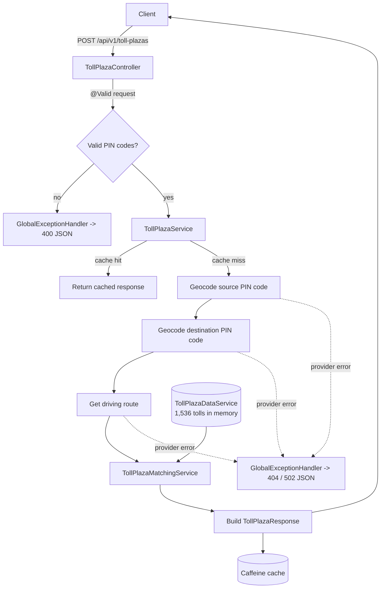

# Toll Plaza Finder

A Spring Boot REST API that takes a source and a destination Indian PIN code and returns the toll plazas that lie along the actual driving route between them, in the order a driver would reach them.

> **Status:** backend API only. There is no frontend yet.

---

## Table of Contents

1. [Problem Statement](#problem-statement)
2. [Key Features](#key-features)
3. [Technology Stack](#technology-stack)
4. [Architecture and Workflow](#architecture-and-workflow)
5. [Project Structure](#project-structure)
6. [Prerequisites](#prerequisites)
7. [Geoapify API Key Configuration](#geoapify-api-key-configuration)
8. [Installation and Setup (Windows)](#installation-and-setup-windows)
9. [Running the Application](#running-the-application)
10. [API Documentation](#api-documentation)
11. [Dataset Processing and Toll Matching](#dataset-processing-and-toll-matching)
12. [Caching Strategy](#caching-strategy)
13. [Testing](#testing)
14. [Configuration Reference](#configuration-reference)
15. [Current Limitations](#current-limitations)
16. [Future Enhancements](#future-enhancements)
17. [Acknowledgements and Attribution](#acknowledgements-and-attribution)

---

## Problem Statement

Before a road trip, a driver may want to know which toll plazas are on the way and roughly how far along the journey each one is. Looking this up manually means tracing a route on a map and cross-checking it against a list of toll plazas.

This project automates that lookup. Given two PIN codes, it:

1. converts each PIN code to a location,
2. fetches the real driving route between the two locations,
3. finds the toll plazas from a CSV dataset that sit on that route, and
4. returns them ordered by distance travelled from the source.

## Key Features

- **Single endpoint:** `POST /api/v1/toll-plazas` with a source and destination PIN code.
- **Strict PIN code validation:** exactly six digits, first digit 1-9, source and destination must differ. Clear JSON error messages.
- **Real driving route:** uses the Geoapify Geocoding and Routing APIs (driving mode).
- **Route-based matching:** a toll plaza is matched by its distance to the route line (point-to-segment distance using the Haversine formula), not by its distance to the straight line between source and destination.
- **Distance along the route:** each toll is positioned by the distance travelled along the route from the source, not by straight-line distance.
- **Configurable matching threshold:** default 2 km, set in `application.properties`.
- **CSV dataset loaded at startup:** validated and de-duplicated into memory (2,385 rows in the file, 1,536 unique records loaded).
- **In-memory caching:** Caffeine cache, up to 1,000 PIN-code pairs, 24-hour expiry.
- **Consistent JSON error responses** via a global exception handler.
- **Automated tests** that never call the real API, plus separate opt-in tests that do.

## Technology Stack

| Area | Technology |
|---|---|
| Language | Java 21 |
| Framework | Spring Boot 4.1.2 (Spring Web MVC) |
| Build tool | Maven |
| HTTP client | Spring `RestClient` |
| JSON | Jackson 3 (bundled with Spring Boot 4) |
| Validation | Jakarta Bean Validation (`spring-boot-starter-validation`) |
| Caching | Spring Cache + Caffeine |
| External services | Geoapify Geocoding API and Geoapify Routing API |
| Testing | JUnit 5, Mockito, Spring `MockMvc`, `MockRestServiceServer` |
| Also on the classpath | Spring Boot Actuator (default settings; no custom management configuration) |

## Architecture and Workflow



**Request flow**

1. `TollPlazaController` receives the request body and triggers bean validation.
2. `TollPlazaService.findTollPlazas` is cached per source/destination pair. On a cache miss it:
   1. geocodes the source PIN code with `GeoapifyGeocodingService`,
   2. geocodes the destination PIN code,
   3. requests the driving route with `GeoapifyRoutingService`,
   4. runs `TollPlazaMatchingService` against the toll plazas from `TollPlazaDataService`,
   5. builds a `TollPlazaResponse`.
3. Validation errors, "not found" results and provider failures are converted to JSON error bodies by `GlobalExceptionHandler`.

## Project Structure

```
toll-plaza-finder/
├── pom.xml
├── mvnw, mvnw.cmd, .mvn/                  # Maven wrapper files
└── src/
    ├── main/
    │   ├── java/com/tollplaza/tollplazafinder/
    │   │   ├── TollPlazaFinderApplication.java
    │   │   ├── config/        CacheConfig                       (enables caching)
    │   │   ├── controller/    TollPlazaController               (POST /api/v1/toll-plazas)
    │   │   ├── service/       TollPlazaService                  (orchestration + @Cacheable)
    │   │   ├── dto/           TollPlazaRequest, TollPlazaResponse, TollPlazaDetail
    │   │   ├── validation/    IndianPincode, DifferentPincodes, DifferentPincodesValidator
    │   │   ├── exception/     GlobalExceptionHandler, ErrorResponse
    │   │   ├── geocoding/     GeoapifyGeocodingService, GeoapifyClientConfig, Coordinate,
    │   │   │                  GeocodingException, LocationNotFoundException
    │   │   ├── routing/       GeoapifyRoutingService, Route,
    │   │   │                  RoutingException, RouteNotFoundException
    │   │   ├── matching/      TollPlazaMatchingService, MatchedTollPlaza, GeoMath
    │   │   └── dataset/       TollPlaza, TollPlazaCsvLoader, TollPlazaDataService,
    │   │                      TollPlazaLoadResult, TollPlazaDataException
    │   └── resources/
    │       ├── application.properties
    │       └── data/toll_plaza_india.csv
    └── test/java/com/tollplaza/tollplazafinder/   # mirrors the main packages
```

## Prerequisites

- **JDK 21** (the project sets `java.version` to 21)
- **Apache Maven** (the commands below were run with Maven 3.10.1)
- A free **Geoapify API key** from <https://www.geoapify.com/>
- Optional: Postman or PowerShell's `Invoke-RestMethod` for trying the API

Check your installation:

```powershell
java -version
mvn -version
```

## Geoapify API Key Configuration

The application reads the key from this property in `src/main/resources/application.properties`:

```properties
geoapify.api.key=${GEOAPIFY_API_KEY:}
```

This means the value comes from the **`GEOAPIFY_API_KEY` environment variable**. The key itself is never stored in the project.

**Do not hardcode your key or commit it to Git.** Keep it in an environment variable only.

If the variable is not set, the application still starts, but any request that needs Geoapify fails with HTTP 502 and the message `Geoapify API key is not configured. Set the GEOAPIFY_API_KEY environment variable.` The key is never logged or included in error messages.

## Installation and Setup (Windows)

1. **Clone the repository** (replace the URL with your own):

   ```powershell
   git clone <your-repository-url>
   cd toll-plaza-finder
   ```

2. **Set the API key for the current PowerShell session:**

   ```powershell
   $env:GEOAPIFY_API_KEY = "your_geoapify_key_here"
   ```

   To keep it for future terminals, store it as a user-level environment variable, then **open a new terminal**:

   ```powershell
   setx GEOAPIFY_API_KEY "your_geoapify_key_here"
   ```

   A terminal or IDE that was already open does not see a variable set with `setx`; restart it.

3. **Build and run the automated tests** (no API key needed):

   ```powershell
   mvn clean test
   ```

## Running the Application

```powershell
mvn spring-boot:run
```

The server starts on Spring Boot's default port, **8080** (no custom port is configured). At startup the CSV is loaded and a summary line is logged, for example total rows, rows loaded, invalid rows skipped and duplicates removed.

You can also build and run the jar:

```powershell
mvn clean package
java -jar target\toll-plaza-finder-0.0.1-SNAPSHOT.jar
```

> The repository also contains Maven wrapper files (`mvnw.cmd`). The commands in this README use an installed Maven (`mvn`).

### Try it

PowerShell:

```powershell
Invoke-RestMethod -Method Post -Uri "http://localhost:8080/api/v1/toll-plazas" `
  -ContentType "application/json" `
  -Body '{"sourcePincode":"560064","destinationPincode":"600001"}'
```

Postman: `POST http://localhost:8080/api/v1/toll-plazas`, body type **raw / JSON**.

## API Documentation

### `POST /api/v1/toll-plazas`

Returns the toll plazas on the driving route from the source PIN code to the destination PIN code.

**Headers**

| Header | Value |
|---|---|
| `Content-Type` | `application/json` |
| `Accept` | `application/json` (optional) |

**Request body**

```json
{
  "sourcePincode": "560064",
  "destinationPincode": "600001"
}
```

| Field | Type | Rules |
|---|---|---|
| `sourcePincode` | string | Required. Exactly 6 ASCII digits, first digit 1-9. |
| `destinationPincode` | string | Required. Same rules. Must differ from `sourcePincode`. |

**Successful response: `200 OK`**

The values below are an example based on one real run (Bengaluru `560064` to Chennai `600001`) with distances rounded; live routing data and results can change, so treat them as illustrative.

```json
{
  "sourcePincode": "560064",
  "destinationPincode": "600001",
  "routeDistanceKm": 377.8,
  "tollPlazas": [
    {
      "tollPlazaName": "Devanahalli Toll Plaza",
      "latitude": 13.1936004,
      "longitude": 77.6472356,
      "distanceFromSourceKm": 19.2
    },
    {
      "tollPlazaName": "Nalluru Devanahalli Toll Plaza",
      "latitude": 13.2066171,
      "longitude": 77.765216,
      "distanceFromSourceKm": 36.0
    },
    {
      "tollPlazaName": "Danamaiahgaaripalli Toll Plaza",
      "latitude": 13.0369241,
      "longitude": 78.5153734,
      "distanceFromSourceKm": 135.9
    },
    {
      "tollPlazaName": "Mahasamudram Toll Plaza",
      "latitude": 13.1952201,
      "longitude": 79.0166834,
      "distanceFromSourceKm": 204.2
    },
    {
      "tollPlazaName": "Vanagaram Toll Plaza",
      "latitude": 13.043582,
      "longitude": 80.149542,
      "distanceFromSourceKm": 363.7
    }
  ]
}
```

| Field | Meaning |
|---|---|
| `routeDistanceKm` | Total driving distance, in kilometres (2 decimal places). |
| `tollPlazas` | Toll plazas on the route, ordered by distance from the source. An empty array means none matched. |
| `tollPlazaName`, `latitude`, `longitude` | Taken from the CSV record. |
| `distanceFromSourceKm` | Distance travelled **along the route** from the source to the toll plaza (2 decimal places). |

### Error responses

All errors share one JSON shape:

```json
{
  "timestamp": "2026-11-18T10:15:30.123Z",
  "status": 400,
  "error": "Bad Request",
  "message": "Validation failed",
  "errors": [
    { "field": "destinationPincode", "message": "Source and destination PIN codes must not be identical" }
  ]
}
```

`errors` lists field-level problems and is an empty array when the error is not tied to a field.

| Status | When | `message` |
|---|---|---|
| `400 Bad Request` | A PIN code is missing | `Validation failed` (field message: `PIN code is required`) |
| `400 Bad Request` | A PIN code is not six digits, contains non-digits or spaces, or starts with 0 | `Validation failed` (field message: `PIN code must be exactly 6 digits and must not start with 0`) |
| `400 Bad Request` | Source and destination are identical | `Validation failed` (field message: `Source and destination PIN codes must not be identical`) |
| `400 Bad Request` | Body is missing or is not valid JSON | `Request body is missing or is not valid JSON` |
| `404 Not Found` | Geoapify finds no location for a PIN code | e.g. `No location found for PIN code 600001` |
| `404 Not Found` | Geoapify finds no route between the locations | `No route found between the given locations` |
| `502 Bad Gateway` | Geoapify returns an HTTP error, times out, returns a malformed response, or the API key is not configured | e.g. `Geoapify geocoding failed for PIN code 560064 (HTTP 401)` |

Other framework-level errors (for example, using `GET` on this endpoint, which returns `405`) are handled by Spring's defaults and do not use the custom error body.

## Dataset Processing and Toll Matching

### CSV dataset

File: `src/main/resources/data/toll_plaza_india.csv`, with columns `longitude`, `latitude`, `toll_name`, `geo_state`.

At startup `TollPlazaCsvLoader` reads the file from the classpath and:

1. checks the header matches the four expected columns (otherwise startup fails with a clear message, as it does when the file is missing),
2. parses each row (quoted fields are supported),
3. skips and logs rows that are malformed, have non-numeric or out-of-range coordinates (longitude -180..180, latitude -90..90), or have a blank name or state,
4. removes **exact** duplicates, using all four fields as the comparison key,
5. keeps the result in memory (`TollPlazaDataService.getAll()`).

For the bundled file: 2,385 data rows, 0 invalid, 849 duplicate rows removed, **1,536 unique records** loaded. The CSV file is only read and never modified.

### Matching approach

`TollPlazaMatchingService` works on the route geometry returned by Geoapify, a list of points joined by straight segments:

1. **Cumulative route distance.** The Haversine distance of each segment is summed so every route point has a known distance from the source.
2. **Distance to the route line.** For each toll plaza, every route segment is checked (with a fast bounding-box pre-filter). The toll is projected onto the segment, clamped to the segment's ends, and the distance from the toll to that closest point is measured with the Haversine formula. Matching is against segments, not only the route's vertices.
3. **Threshold.** If the smallest such distance is within the threshold, the toll is on the route. The default is **2 km**, configurable with `tollplaza.matching.threshold-km`.
4. **Position along the route.** `distanceFromSourceKm` is the cumulative route distance up to the closest point on the route, not the straight-line distance from the source.
5. **Ordering and duplicates.** Results are sorted by distance from the source. Identical toll records are reported once, and a toll that the route passes twice is reported once, at its closest (earliest on ties) pass.

Coordinate order is kept explicit: GeoJSON `[longitude, latitude]` pairs from Geoapify are mapped into `Coordinate(latitude, longitude)` objects, and the CSV record stores longitude and latitude by name.

## Caching Strategy

`TollPlazaService.findTollPlazas` is annotated with `@Cacheable` and backed by a **Caffeine** cache named `tollPlazas`:

| Setting | Value |
|---|---|
| Max entries | 1,000 |
| Expiry | 24 hours after write |
| Key | `<sourcePincode>-><destinationPincode>` (order matters: A to B and B to A are separate entries) |

Configured in `application.properties`:

```properties
spring.cache.type=caffeine
spring.cache.cache-names=tollPlazas
spring.cache.caffeine.spec=maximumSize=1000,expireAfterWrite=24h
```

- Only successful results are cached. Errors (validation, not found, provider failures) are never cached and are retried on the next request.
- A cache hit makes no Geoapify calls.
- The cache is in memory, per application instance. It is cleared on restart.

**Seeing a hit versus a miss:** on a cache miss the service logs a line such as `Route 560064 -> 600001: 377.85 km, 5 toll plaza(s) found`. On a cache hit that method body does not run, so no such line appears.

## Testing

### Automated tests (no network, no API key)

```powershell
mvn clean test
```

These tests use mocks (`MockRestServiceServer`, Mockito) and hand-built routes. The real Geoapify API is never called. At the time of writing, the suite runs **110 tests** across:

| Area | Test classes |
|---|---|
| CSV loading | `TollPlazaCsvLoaderTest`, `TollPlazaDataServiceTest` |
| Validation and DTOs | `PincodeValidationTest`, `TollPlazaResponseTest` |
| Error handling | `GlobalExceptionHandlerTest` |
| Geocoding (mocked HTTP) | `GeoapifyGeocodingServiceTest` |
| Routing (mocked HTTP) | `GeoapifyRoutingServiceTest` |
| Matching | `TollPlazaMatchingServiceTest`, `GeoMathTest`, `TollPlazaMatchingIntegrationTest` |
| Service and caching | `TollPlazaServiceTest`, `TollPlazaServiceCachingTest` |
| Controller (`MockMvc`, mocked service) | `TollPlazaControllerTest` |
| Application context | `TollPlazaFinderApplicationTests` |

### Real API integration tests (opt-in)

Three test classes end in `IT` and call the **real Geoapify APIs**. They are not run by `mvn clean test`, and they are enabled only when `GEOAPIFY_API_KEY` is set:

| Class | What it checks |
|---|---|
| `GeoapifyGeocodingServiceRealApiIT` | Geocodes PIN code `560064` |
| `GeoapifyRoutingServiceRealApiIT` | Geocodes `560064` and `600001`, then fetches the route |
| `TollPlazaMatchingRealRouteIT` | Geocoding, routing and matching on the real 1,536-record dataset |

Run one explicitly (these use your API quota):

```powershell
$env:GEOAPIFY_API_KEY = "your_geoapify_key_here"
mvn test "-Dtest=TollPlazaMatchingRealRouteIT"
```

The assertions check structure and invariants (valid ordering, distances within the route, no duplicates), not fixed toll counts or names, because live data can change. `TollPlazaMatchingRealRouteIT` also writes a diagnostic summary to `target/real-route-it-report.txt`; the file contains no API key.

## Configuration Reference

All settings live in `src/main/resources/application.properties`:

| Property | Value in the project | Purpose |
|---|---|---|
| `spring.application.name` | `toll-plaza-finder` | Application name |
| `geoapify.api.key` | `${GEOAPIFY_API_KEY:}` | Geoapify key, read from the environment |
| `tollplaza.matching.threshold-km` | `2.0` | Max distance (km) from the route line for a toll to match |
| `spring.cache.type` | `caffeine` | Cache implementation |
| `spring.cache.cache-names` | `tollPlazas` | Cache name |
| `spring.cache.caffeine.spec` | `maximumSize=1000,expireAfterWrite=24h` | Cache size and expiry |

Optional (default in code, not in the properties file): `geoapify.base-url` defaults to `https://api.geoapify.com`. HTTP timeouts are fixed in code: 5 s to connect, 10 s to read.

## Current Limitations

- **Backend only.** There is no frontend, authentication, rate limiting or API documentation UI.
- **PIN code geocoding is approximate.** Each PIN code becomes one point, the first Geoapify result for `"<pincode>, India"`. Large PIN code areas are not a single location, so the route start and end are approximations.
- **One route only.** The first route returned by Geoapify in driving mode is used. There is no choice of vehicle type, alternative routes or avoiding tolls.
- **Coverage depends on the CSV.** Only toll plazas in `toll_plaza_india.csv` can be returned. The source, completeness and currency of that dataset have not been verified, and tolls are not guaranteed to be complete or up to date.
- **Matching accuracy is unmeasured.** The 2 km threshold is a starting value and has not been tuned or benchmarked against a reference. A toll near the threshold may be included or missed.
- **Exact-duplicate removal only.** Two entries for the same physical toll with different coordinates or spelling would both be loaded.
- **No toll fees or travel direction.** The API returns names, coordinates and distances only.
- **Cache is in memory and per instance.** It is not shared between instances and is lost on restart; route or dataset changes can take up to 24 hours to appear for a cached PIN-code pair.
- **Requires internet access and a valid Geoapify key** for real requests, and is subject to Geoapify's plan limits.

## Future Enhancements

- A simple web frontend with a map view
- Toll fee information and vehicle-type support
- OpenAPI/Swagger documentation
- Threshold tuning and an accuracy evaluation against reference routes
- Smarter de-duplication of near-identical toll records
- Alternative routes
- Docker support and a CI pipeline
- Shared caching (for example Redis) and cache hit/miss metrics through Actuator
- Rate limiting and basic API authentication

## Acknowledgements and Attribution

Routing and geocoding are provided by [Geoapify](https://www.geoapify.com/), which uses [OpenStreetMap](https://www.openstreetmap.org/copyright) data.

According to Geoapify's terms and conditions (checked at <https://www.geoapify.com/terms-and-conditions/>), OpenStreetMap attribution is required for all Geoapify services, and Geoapify attribution is required on the Free plan. If you publish results from this project, for example in a UI built on top of it, include:

- **Powered by [Geoapify](https://www.geoapify.com/)**
- **© [OpenStreetMap](https://www.openstreetmap.org/copyright) contributors**

Please review Geoapify's current terms for the exact requirements of your plan.
